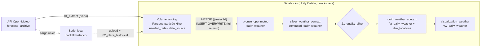
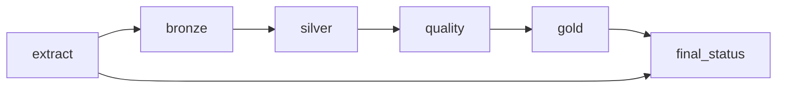

# lab-pipeline-openmeteo

Pipeline de dados ponta a ponta sobre a API pública do [Open-Meteo](https://open-meteo.com/): extração diária, camadas bronze → silver → gold, checagem de qualidade, orquestração agendada e alerta de falha, tudo no **Databricks Free Edition** com código versionado neste repositório.

O foco não é o clima: é o desenho de um pipeline que **não perde dado em silêncio**. Cada decisão abaixo tem um teste que provoca a falha que ela evita.

## Arquitetura



| Camada | Objeto | Papel |
|---|---|---|
| Landing | Volume `raw_openmeteo.landing` | Arquivos brutos da API, como vieram. Fonte da verdade para reconstruir a bronze |
| Bronze | `bronze_openmeteo.daily_weather` | Espelho tipado e deduplicado: uma linha por cidade por dia, nomes da origem, sem regra de negócio |
| Silver | `silver_weather_context.computed_daily_weather` | Regras de negócio: renomeia, calcula amplitude, dia chuvoso e grupo do tempo |
| Gold | `gold_weather_context.fat_daily_weather`, `dim_locations` | Fato enxuta com chave de controle (`sha1`) e `updated_control`; dimensão de cidades |
| Consumo | `visualization_weather.vw_daily_weather` | View pronta para BI |

## Orquestração

Job `pipeline-openmeteo`, agendado todo dia às 06:30 (America/Sao_Paulo), concorrência máxima 1, e-mail em caso de falha. Todas as tarefas leem o código **da branch `main` deste repositório**: código só chega à execução por PR mergeado.



`final_status` roda com **Run if: All done** e lê, via `taskValues`, a lista de cidades que falharam na extração. A falha de uma cidade não segura as outras, mas a execução termina **vermelha** e o alerta chega.

## Decisões de desenho

| Decisão | Por quê |
|---|---|
| Gravar arquivo na landing antes de qualquer tabela | Reprocessar sem chamar a API de novo, auditar o que a API devolveu e reconstruir a bronze num full refresh |
| Partição Hive `inserted_date=/data_source=` no caminho | A leitura poda pastas pela data de carga; a cidade não se repete dentro do arquivo |
| Schema explícito no Parquet (pyarrow) | Sem ele, um dia com nulo muda o tipo inferido e a leitura de vários dias quebra |
| Chave `data_source` + `date` `NOT NULL` na bronze | Uma chave nula nunca casa no `MERGE` e seria reinserida a cada execução; aqui a escrita falha na hora |
| Janela incremental de 7 dias **pela data de carga** | Tolera arquivo que chega atrasado; uma janela de 1 dia deixaria esse arquivo órfão para sempre |
| `MERGE ... WHEN MATCHED AND s.extracted_at > t.extracted_at` | Só a extração mais recente sobrescreve; reexecutar não duplica nem regride |
| Histórico extraído fora do Databricks | A API de arquivo devolveu **429** para o IP de saída compartilhado do serverless; a carga única roda na máquina local e sobe para o Volume |
| Retry com espera de 30/60/120 s para 429 e 5xx | 429 é recuperável, não é falha permanente |
| Cidades sem valor padrão | Lista de entidades nunca tem default silencioso; parâmetro vazio derruba a tarefa antes de chamar a API |
| Checagem de qualidade entre silver e gold | Tabela vazia, chave nula, chave duplicada ou mínima > máxima derrubam o Job antes da gold |
| `LEFT JOIN` da fato com a dimensão | Cidade sem cadastro aparece com nome nulo, em vez de sumir da view |
| `CASE` do grupo do tempo com `ELSE 'unknown'` | `CASE` sem `ELSE` vira `NULL` calado |

## Testes feitos

Cada linha foi executada e conferida pelo efeito nos dados, não pela cor do Job.

| Teste | Resultado |
|---|---|
| Carga completa (full refresh) com histórico + diário | 1.041 dias por cidade, de 2024-01-01 a 2026-11-06: exatamente o número de dias do calendário |
| Reexecução incremental | Contagens idênticas (idempotência) |
| Execução agendada pelo Job | +1 dia nas três cidades, propagado até a view |
| Reprocessar uma data só por parâmetro | O dia foi substituído (novo `extracted_at`), sem duplicar |
| Falha parcial (uma cidade com latitude inválida) | As outras cidades processadas até a gold; `final_status` vermelho; Job **Failed**; e-mail recebido |
| Perda na landing + full refresh | O histórico de uma cidade caiu de 1.042 para **8 linhas sem nenhum erro**; recuperado com `RESTORE TABLE ... TO VERSION AS OF` |
| Consultas de [validação](validation/) | Camadas no mesmo dia, nenhuma duplicidade, nenhum buraco no calendário |

## Validação

Três consultas em [`validation/`](validation/) para responder "o pipeline está saudável?" sem confiar no status da execução:

- [`01_frescor_por_camada.sql`](validation/01_frescor_por_camada.sql): até que dia cada camada chegou e quando cada cidade foi extraída pela última vez;
- [`02_duplicidade.sql`](validation/02_duplicidade.sql): chave repetida em qualquer camada (esperado: vazio);
- [`03_buracos_calendario.sql`](validation/03_buracos_calendario.sql): dias faltando no meio da série (esperado: vazio).

**Limitação conhecida:** a consulta de buracos não detecta perda no **começo** da série. Quando o histórico some, o primeiro dia anda junto e o calendário "encolhe". O teste de perda acima só foi pego comparando a contagem com a execução anterior.

## Estrutura do repositório

```
databricks/
  00_setup.sql                        schemas, Volume e tabela bronze
  01_extract_openmeteo.py             API → Parquet na landing (retry, falha por cidade)
  02_place_historical.py              move o backfill para a árvore Hive
  10_bronze_daily_weather.py          MERGE incremental / INSERT OVERWRITE no full refresh
  20_silver_computed_daily_weather.sql regras de negócio
  21_quality_silver.py                checagens que derrubam o Job
  30_gold.sql                         fato, dimensão e view
  90_final_status.py                  falha alta se alguma cidade ficou de fora
scripts/backfill_historical.py        carga única do histórico, na máquina local
validation/                           consultas de saúde do pipeline
.github/workflows/                    sincroniza o Git folder do Databricks a cada merge na main
```

## Como reproduzir

1. Crie uma conta no Databricks Free Edition e ligue este repositório como **Git folder** (token fine-grained do GitHub com `Contents: Read and write`).
2. Rode `databricks/00_setup`.
3. Na máquina local: `pip install requests pyarrow` e `python scripts/backfill_historical.py`. Suba os arquivos de `data/historical_upload/` para `landing/_upload` e rode `databricks/02_place_historical`.
4. Rode `01_extract_openmeteo` com as cidades no widget `cities`, depois `10_bronze_daily_weather` com `full_refresh = true`, e em seguida `20`, `21` e `30`.
5. Crie o Job com as tarefas do diagrama de orquestração, fonte Git na branch `main`.

Nenhuma credencial fica no repositório: o token do GitHub fica no Databricks, e o host e o token do Databricks ficam nos *secrets* do GitHub Actions.

## Próximos passos

- Versionar o próprio Job como código com Databricks Asset Bundles e fazer o deploy pelo GitHub Actions.
- Painel no Databricks sobre a `vw_daily_weather`.
- Checagem de contagem entre execuções, para pegar perda no começo da série.
